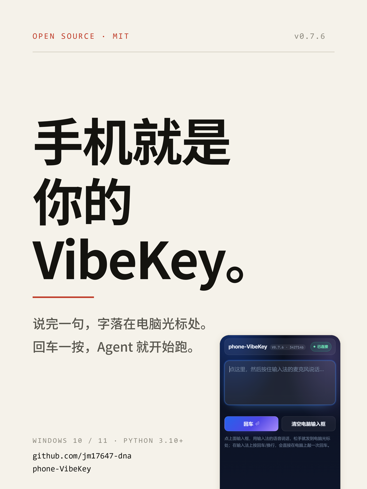
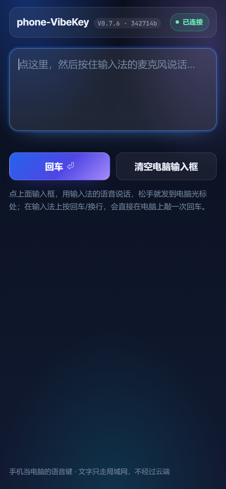
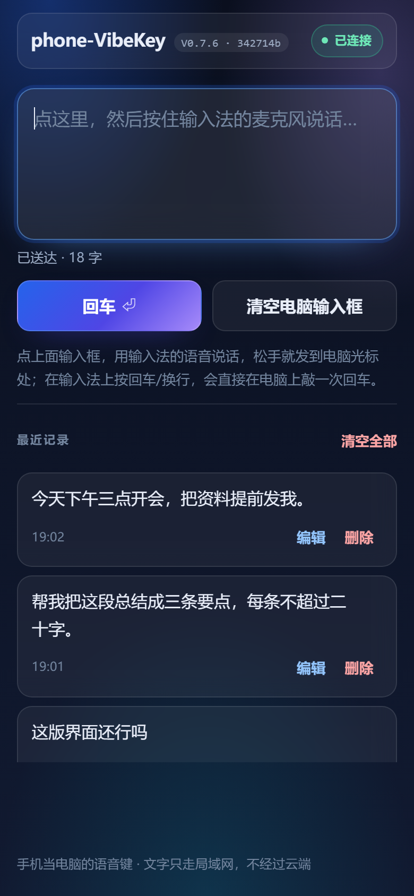

<p align="center">
  
</p>

<h1 align="center">phone-VibeKey</h1>

<p align="center">
  <b>把手机当成电脑的语音键。</b><br>
  说完一句，字直接落到光标处；按一下回车，Agent 就开始跑。
</p>

<p align="center">
  <code>Windows 10 / 11</code> · <code>Python 3.10+</code> · <code>局域网直连</code> · <code>MIT</code> · 零月费
</p>

---

## 一分钟看懂

| 你本来要做的 | 现在 |
| --- | --- |
| 给台式机找麦克风 | 手机自带麦克风就够了 |
| 买一只语音键硬件 | 不用买，不装 App |
| 手机说完，切到电脑，翻聊天记录，粘贴 | 松手即落字到光标处 |
| 用 Agent 时还得回键盘按回车 | 手机上按一下，电脑真的敲一次 Enter |

识别发生在**你手机里的输入法**上（微信、豆包、讯飞、Gboard 都行），这台电脑只做一件事：**把文字写进当前光标**。

```
 手机浏览器 ──WiFi──▶ 路由器 ──▶ PC 托盘进程 ──▶ 剪贴板 + Ctrl+V ──▶ 光标处
   （输入法语音）                   （WebSocket）        （SendInput）
```

不录音、不传音频、不经过云。整条链路只在你自己的局域网里。

## 为什么不用 App、不用输入法插件

- **手机端零安装**：扫一下电脑上的二维码，浏览器打开就是界面，可以「添加到主屏幕」当图标用。
- **语音能力直接用输入法现成的**：准确率和你平时在微信里说话一样，不用为识别付费。
- **电脑端只有一个托盘图标**：常驻几十 MB，占用一个端口，其余什么都不碰。

## 功能

| 能力 | 说明 |
| --- | --- |
| 边说边出字 | 输入法上屏的字实时同步到手机页面 |
| 松手即落字 | 松手后 2 秒内出现在电脑当前光标处 |
| 增量发送 | 续写只发新增部分，不重影、不粘连、不乱序 |
| 远程回车 | 手机点「回车 ⏎」或输入法按换行，电脑直接敲 Enter |
| 一键擦掉 | 「清空电脑输入框」退掉刚落下去的那段字 |
| 最近 10 条 | 可编辑、可重发、可单条删除，清空要二次确认 |
| 断线自愈 | 换网、锁屏、电脑重启后自动重连，不用重扫码 |
| 找不到输入框不吞字 | 光标不在输入框时，文字留在手机并进剪贴板，提示你重发 |

## 快速开始

```powershell
# 1. 装依赖（需要 Python 3.10+，勾选 Add to PATH）
python -m pip install -r pc/requirements.txt

# 2. 启动（双击也行，会以无窗口进程常驻托盘）
pc\启动.cmd
```

3. 托盘图标 → **显示配对二维码**
4. 手机用系统「扫一扫」扫码 → 页面打开、输入框自动聚焦
5. 点页面里的输入框 → 用输入法的麦克风说话 → 松手，字就落在电脑上

> 手机连不上：点托盘里的 **修复手机连不上（防火墙）**，会自动为专用网络放行端口。

## 能用 / 不能用

**能用**

- 手机和电脑在同一个 WiFi（电脑走网线也算，只要出口是同一台路由器）
- 双层路由（光猫 + 小米/华硕路由器）、手机开热点给电脑
- 微信、钉钉、飞书、QQ、Word、浏览器、VS Code、终端里的输入框

**不能用**

- 手机用流量、人和电脑不在一张网（本版本不做公网中转）
- 管理员权限窗口、全屏游戏、远程桌面、锁屏界面
- 开了 AP 隔离的访客网络、公司/校园网
- macOS / Linux 电脑（只做 Windows）

## 隐私

- 音频永远留在手机里，本工具只收到**识别后的文字**。
- 文字只在局域网内传输，没有中转服务器，没有账号体系。
- 代码全开源，随时可以自己审计、自己改。
- ⚠️ 输入法本身是否把音频上云，取决于你用的是哪个输入法。

## 截图

<table>
  <tr>
    <td width="33%"></td>
    <td width="33%"></td>
    <td width="33%"></td>
  </tr>
  <tr>
    <td align="center">点输入框，用输入法说话</td>
    <td align="center">说完自动发走，留在最近记录</td>
    <td align="center">上滑撤回、松手编辑都是输入法原生</td>
  </tr>
</table>

更多宣传图（1080×1440，可直接发小红书）：[`docs/xiaohongshu/`](docs/xiaohongshu/)

## 完整说明

- [使用手册（使用范围 + 网络环境完整说明）](docs/使用手册.md)
- [小红书文案与配图](docs/xiaohongshu/)
- [更新日志](CHANGELOG.md)

## 目录

```
phone-VibeKey/
├─ pc/                    Windows 端（Python，无框架依赖）
│  ├─ agent.py            aiohttp 服务 + 托盘 + 配对二维码
│  ├─ inject.py           ctypes 剪贴板 + SendInput 注入
│  ├─ showqr.py           二维码窗口
│  ├─ 启动.cmd            双击启动（pythonw 无窗口）
│  └─ *_test.py           端到端测试
├─ web/                   手机页面（原生 JS，无构建）
│  ├─ index.html app.js style.css
│  └─ fonts/              自托管 Inter / JetBrains Mono
└─ docs/                  使用手册、宣传图、截图
```

## 开发

```powershell
python pc/selftest.py      # HTTP + WebSocket + 真实注入全链路
python pc/keytest.py       # 远程回车
python pc/cleartest.py     # 增量续写 + 清空
python pc/dedup_test.py    # 去重
node web/domtest.mjs       # 页面逻辑（DOM 桩）
node web/diff_test.mjs     # 增量发送
node web/ep_test.mjs       # 多地址自动切换
```

页面左下角显示 `V0.7.6 · 构建号`，构建号是三个前端文件的 sha1 前 7 位，改一行就会变，方便确认手机上跑的是哪一版。

## 已知限制

- 只支持 Windows 注入；浏览器/微信这类窗口如果光标其实不在输入框，工具判断不了，会把文字放进剪贴板并提示。
- 替换已落字依赖「退格 N 次」，极少数不接受退格的编辑器（部分终端）可能残留。
- 端口默认 8765，可在 `%APPDATA%\phone-VibeKey\config.json` 改，改完需重放防火墙规则。

## License

[MIT](LICENSE) © 2026 phone-VibeKey contributors