# phone-VibeKey · 手机就是你的 VibeKey

> 不买硬件、不装 App：把手机当成电脑的语音键。说完一句，字直接落到光标处；按一下回车，Agent 就开始跑。

> 📖 完整说明（使用范围 · 网络环境 · 排障）见 **[docs/使用手册.md](docs/使用手册.md)**

<p align="center">
  
</p>

台式机没麦克风，也不必为它单独买一只语音键。手机本来就在手边——打开一个网页，用你常用的输入法说话，文字边出边同步到电脑光标处，松手即落字；想把这段话交给 Agent，顺手点一下回车。全程不碰音频、不经过云服务，开源、零月费。

```
 手机浏览器（添加到主屏幕）                     Windows PC
┌────────────────────────┐   WebSocket    ┌──────────────────────────┐
│  输入框（输入法语音出字）│ ─────────────▶ │  agent.py  (aiohttp)     │
│  停顿 0.7–1.2s 自动发送 │   局域网/同一WiFi │   ↓                      │
│  换行键 → 电脑按回车    │ ◀───────────── │  inject.py (ctypes)      │
│  清空电脑输入框         │     ack          │  剪贴板 + Ctrl+V / 退格   │
└────────────────────────┘                └──────────────────────────┘
```

## 一图看懂

九张宣传卡片，按「痛点 → 原理 → 用法 → 边界」顺序过一遍，比读文档快：

| 封面 | 痛点 | 原理 |
| :---: | :---: | :---: |
|  |  | 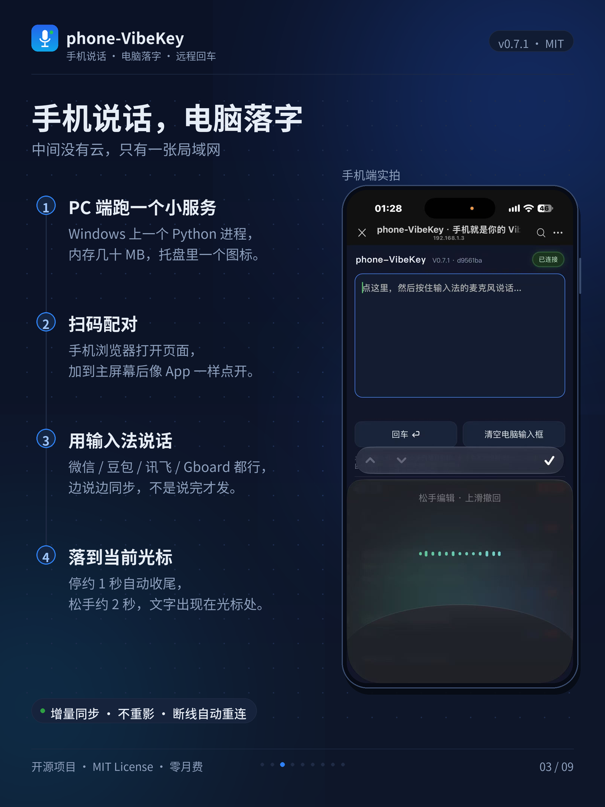 |
| **语音中** | **Agent 加成** | **适用环境** |
| 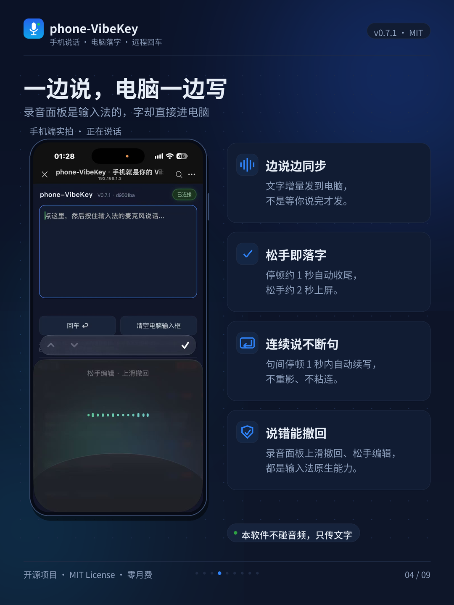 | 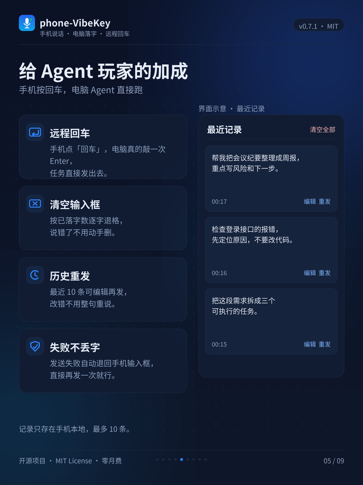 | 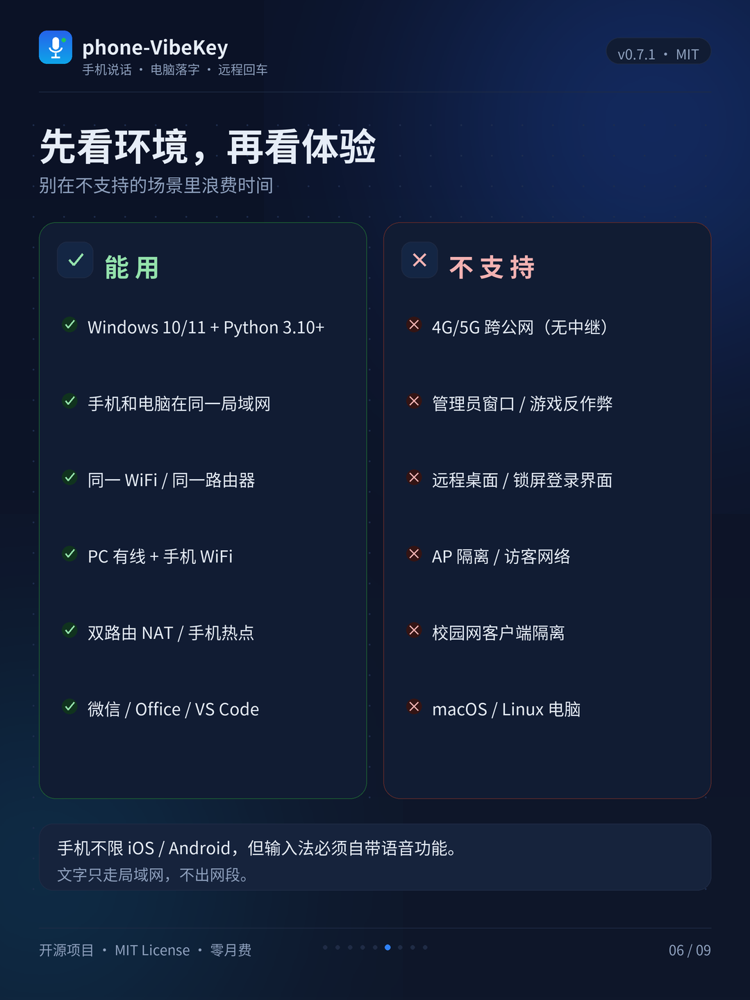 |
| **上手 3 步** | **隐私** | **收尾** |
| 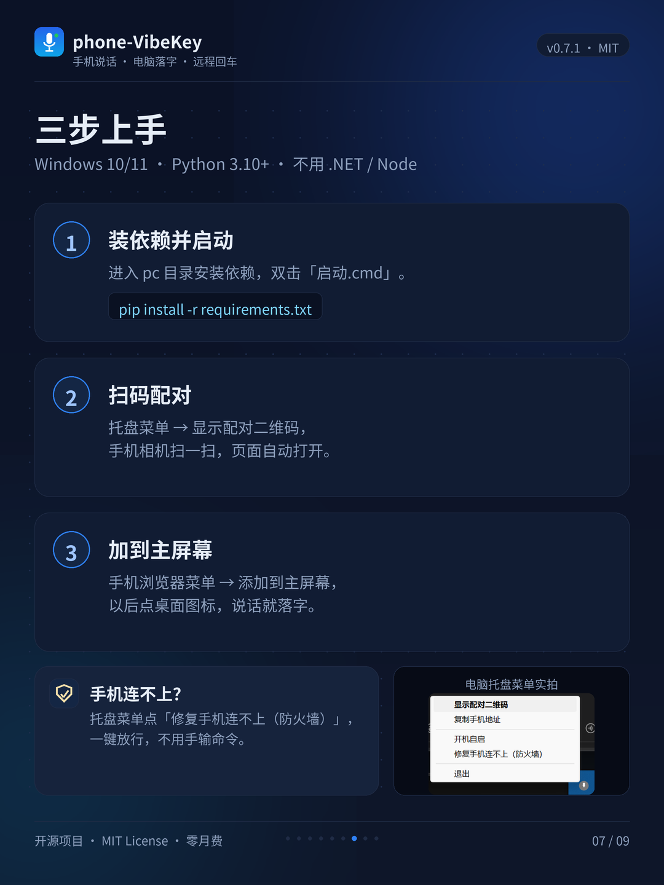 | 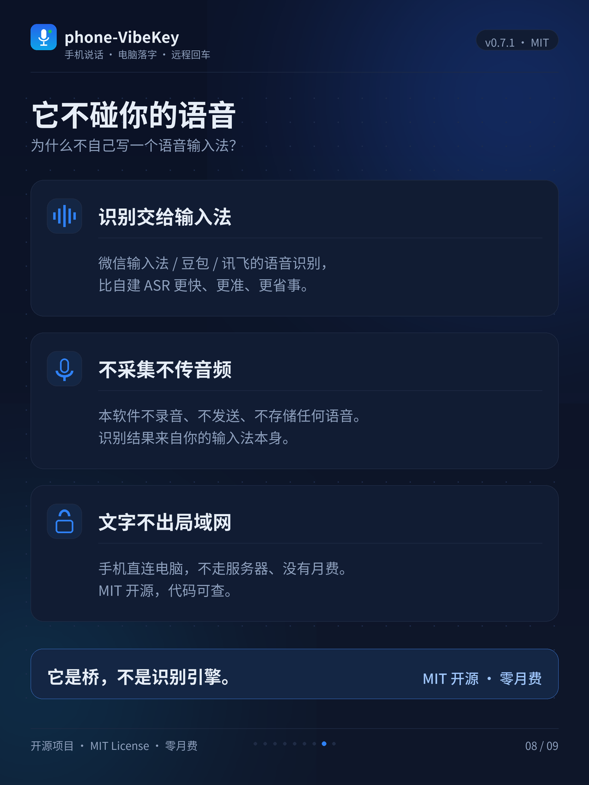 | 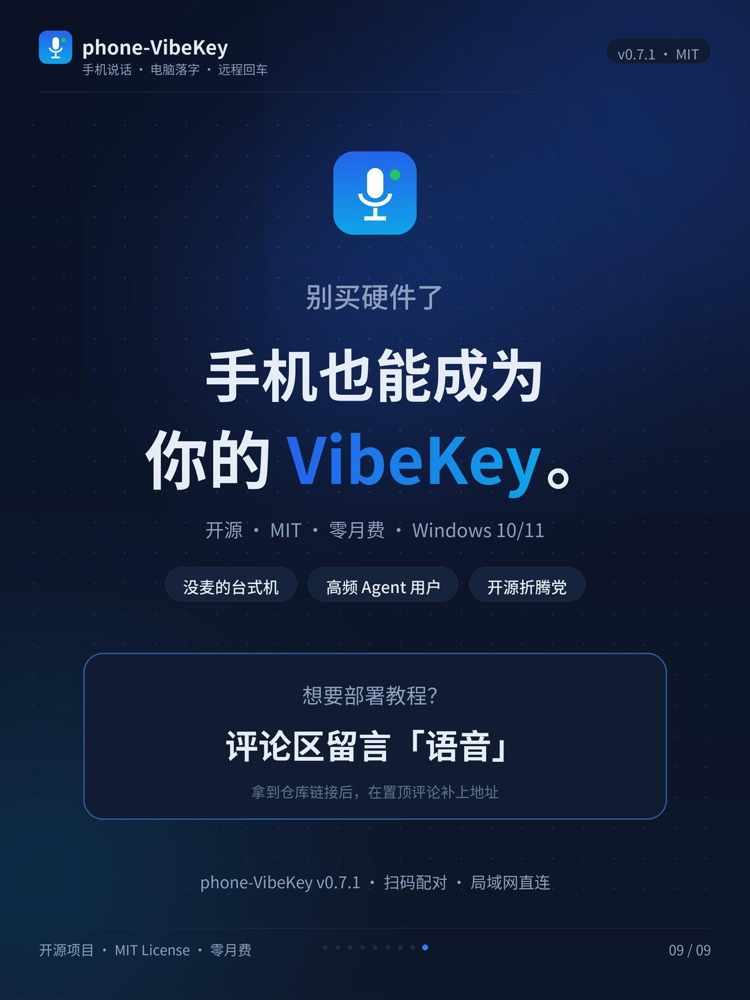 |

> 配套宣传文案见 **[docs/xiaohongshu/小红书文案.md](docs/xiaohongshu/小红书文案.md)**；全部卡片由 [生成图片.py](docs/xiaohongshu/生成图片.py) 渲染，改完文案可直接重跑。

## 为什么是「网页 + 输入法」而不是自己写 Android 输入法

一开始的目标是做一个 Android 语音输入法。真做下去才发现，语音识别那一层早就被手机输入法（微信输入法、豆包、讯飞）做得很好，自己接云端 ASR 只会更慢、更贵、更不准。

所以这个项目的定位是：**只做「把字送到电脑」这一段**。手机端就是一个网页，你把光标放进输入框，用熟悉的输入法语音输入，文字上屏的同时就被同步到电脑。

好处：

- 零 ASR 成本、零模型部署，识别质量取决于你用的输入法（通常比自建更好）
- 手机端不装 App、不常驻后台、不申请任何权限
- 电脑端只有一个 Python 进程，内存几十 MB

## 功能

- 说话时**边出字边同步**：文字增量发到电脑，不是等说完才发
- 松手/停顿约 1 秒自动收尾，电脑上落的就是完整一句
- 手机上按输入法的**换行/回车**键 → 电脑上真的敲一次回车
- **清空电脑输入框**：按已落字的字数逐个退格
- 电脑没有输入框时（桌面、资源管理器）**不误删、不吞字**，改为把文字放进剪贴板
- 发送失败自动把文字放回手机输入框，不用重说
- 最近 10 条记录：可编辑重发、删除、一键清空
- 断线自动重连；电脑重启后手机无需重新扫码
- 页面左上角显示版本号 + 构建号，方便判断手机是不是最新版

## 快速开始（Windows PC）

要求：Windows 10/11 + Python 3.10 以上（不需要 .NET、Node）。

```powershell
cd pc
python -m pip install -r requirements.txt
pythonw agent.py        # 无控制台常驻；调试时用 python agent.py
```

启动后：

1. 任务栏出现 phone-VibeKey 图标
2. 托盘菜单 → **显示配对二维码**
3. 手机用**系统相机/扫一扫**扫这个二维码（不用微信扫）
4. 浏览器打开配对地址，输入框自动聚焦，直接按住输入法的麦克风说话

> 也可以用「复制手机地址」，手动在手机浏览器里打开。

### 开机自启

托盘菜单 → 开机自启（写 `HKCU\Software\Microsoft\Windows\CurrentVersion\Run`）。

### 手机连不上？

托盘菜单 → **修复手机连不上（防火墙）**，会弹 UAC 并按「当前 Python 程序 + 专用/域/公用网络」放行入站，不需要手动输命令。

> Windows 把网络识别成「公用网络」时规则默认不生效，这里的规则三种配置文件都覆盖了。

## 手机端使用

| 操作 | 效果 |
|---|---|
| 点输入框，按住输入法麦克风说话 | 边说边同步到电脑 |
| 停止说话约 1 秒 | 会话收尾，整段落定 |
| 输入法上按换行/回车 | 电脑上敲一次回车 |
| Shift + 回车 | 手机输入框里换行（不发给电脑） |
| 清空电脑输入框 | 把电脑上刚落的那段退格掉 |
| 最近记录 → 编辑 | 把旧句子放回输入框，可改完再发 |

想把网页当 App 用：Safari → 分享 → **添加到主屏幕**，之后从桌面图标进入。

## 它是怎么工作的

### 网络拓扑（这就是为什么 PC 必须是服务端）

家里很常见的一种接法：PC 用网线接主路由（`192.168.1.x`），手机连另一个路由器（`192.168.31.x`）的 WiFi。两层 NAT 下：

- **手机 → PC 通**（小米路由做 SNAT，源 IP 到 PC 时统一变成 `192.168.1.2`）
- **PC → 手机 不通**（PC 路由表里没有 `192.168.31.0/24`，也没有回程路由）

所以：PC 起服务、手机主动连它。mDNS/UDP 广播跨不过 NAT，设备发现只能靠二维码。

同理，**不能按来源 IP 做设备识别**——所有手机在 PC 眼里都是同一个 IP，鉴权只能靠 token。

### 通信协议

WebSocket，路径 `/ws?t=<token>`，JSON 消息：

```jsonc
// 客户端 → 服务端
{"type": "hello", "token": "..."}
{"type": "text",  "text": "要粘贴的文字", "replace": false}
{"type": "key",   "key": "enter"}
{"type": "clear"}
{"type": "ping"}

// 服务端 → 客户端
{"type": "welcome", "connected": 1}
{"type": "ack", "ok": true, "reason": ""}
{"type": "ack", "kind": "clear", "ok": true, "count": 15}
{"type": "ack", "ok": true, "pasted": false, "reason": "no-input-focus"}
{"type": "ack", "ok": true, "deduped": true}
{"type": "error", "reason": "bad-token"}
```

### 为什么是「增量发送」而不是每次整段重贴

输入法是一段一段把字上屏的。如果每段都整段重贴，就会出现「前一句还在、后一句也贴上」的重影。

所以手机端记住「上一次发出去的全文」，新内容以旧内容开头时**只发新增的后缀**；只有内容被改短/改错时才发 `replace: true`，由 PC 端退格掉 `chain_len` 个字再重贴。

### 重复消息怎么办

网络抖动或重连时，同一段话可能二次到达。PC 端对「1.5 秒内内容完全相同、且不是整体替换」的消息直接回 `deduped: true`，不再粘一遍——否则用户会看到重复的一行字。

### 粘贴是怎么做的

`inject.py` 只用 ctypes（不依赖 pywin32 / pyperclip）：

1. 保存当前剪贴板
2. 写入文字 → `Ctrl+V` → 等待 220ms
3. **只在剪贴板仍是我们写的那段时**才恢复原内容（避免覆盖用户刚复制的东西）
4. 校验 `SendInput` 返回值，失败就报错而不是假装成功

> 踩过一个坑：x64 上 `INPUT` 结构体大小必须是 40 字节。只声明 `KEYBDINPUT` 会让 `sizeof(INPUT)=32`，`SendInput` 直接返回 0 + `ERROR_INVALID_PARAMETER(87)`，表现是「程序说粘了，但什么都没发生」。

### 光标不在输入框时

`focused_edit_state()` 用 `GetGUIThreadInfo` 判断前台焦点：

- 有插入符 / 已知编辑控件类 → `editable`，正常粘贴
- 桌面、资源管理器、任务栏（`Progman`/`WorkerW`/`CabinetWClass`…）→ `container`，**不粘贴也不退格**，只把文字放进剪贴板并告知手机
- 其它应用窗口 → `unknown`，照常粘贴

## 目录结构

```
phone-VibeKey/
├─ pc/                     Windows 端
│  ├─ agent.py             aiohttp 服务 + pystray 托盘 + 配对二维码
│  ├─ inject.py            ctypes 剪贴板 / SendInput / 焦点判断
│  ├─ showqr.py            tkinter 二维码窗口（子进程，避免 Tk 和 asyncio 抢线程）
│  ├─ requirements.txt
│  ├─ setup_firewall.ps1   手动放行防火墙（管理员）
│  ├─ 启动.cmd             优先用 pythonw 启动
│  ├─ selftest.py          端到端：起服务 + 造目标窗口 + 断言最终文本
│  ├─ keytest.py           远程回车测试
│  ├─ cleartest.py         增量续写 + 清空测试
│  ├─ dedup_test.py        重复消息幂等测试
│  └─ target_window.py     测试用 Tk 窗口，每 250ms 把内容写文件
└─ web/                    手机端页面
   ├─ index.html
   ├─ app.js               发送调度 / 增量 diff / 重连 / 历史
   ├─ style.css
   ├─ manifest.webmanifest
   ├─ icon.svg             应用图标（矢量，无需 PNG）
   ├─ domtest.mjs          用 DOM 桩直接跑 app.js
   ├─ diff_test.mjs        增量发送逻辑测试
   └─ ep_test.mjs          候选地址故障切换测试
```

## 开发与测试

```powershell
# 端到端（会自己起一个 8799 端口的临时 agent + 一个 Tk 目标窗口）
cd pc
python selftest.py          # 期望最后一行 RESULT MATCH
python keytest.py           # 期望 RESULT PASS
python cleartest.py         # 期望 count: 15 / final text repr: '' / RESULT PASS
python dedup_test.py        # 期望 RESULT PASS

# 前端逻辑（需要 node，仅测试用）
cd web
node domtest.mjs
node diff_test.mjs
node ep_test.mjs            # 期望 connected to alt: true / RESULT PASS
```

调试手机端：地址后加 `&debug=1`，页面底部会多一个事件日志浮层（`comp.start` / `comp.end` / `debounce(ms,len,gaps)` / `send(replace,len)` / `ack` / `ws.open|close`），定位「为什么这句没发」很快。

## 网络适应性

能不能用，只取决于**手机能否主动连到 PC 的 IP:端口**。

| 环境 | 是否支持 | 说明 |
|---|---|---|
| 同一 WiFi、同一网段 | ✅ | 最优路径，延迟最低 |
| PC 有线 + 手机 WiFi（同路由器） | ✅ | 二维码里会带多个候选地址 |
| 双 NAT（PC `192.168.1.x`、手机 `192.168.31.x`） | ✅ | 手机侧 SNAT，只要 PC 当服务端就通 |
| 手机开热点、PC 连手机热点 | ✅ | PC 会出现在热点网段，二维码自动带上 |
| 多网卡（有线 + WiFi + 虚拟网卡同时存在） | ✅ | 扫码后按顺序试，哪个通记哪个 |
| 换了 WiFi / 换网段 / PC 重启 | ✅ | 自动按退避重连，回前台或网络恢复时立刻重试 |
| 路由器开了 AP 隔离 / 访客网络 | ❌ | 路由层禁止客户端互访，直连无解 |
| 公司/校园网只放行 80/443 | ❌ | 非标准端口被丢，需要中继 |
| 手机用 4G/5G、PC 在家宽后 | ❌ | 运营商 CGNAT，PC 无公网入站 |
| 手机只有 IPv6 的蜂窝网络 | ❌ | PC 侧没有可路由的公网 v6 |

后四种都需要「第三条通道」（Tailscale / Cloudflare Tunnel / 自建中继），尚未实现。

### 为什么没有「自动发现」

网页里的 JavaScript **不能**发 mDNS、不能广播、也扫不了局域网——浏览器沙箱没有这个能力。所以发现只能靠扫二维码（二维码里带了全部候选地址），或手动填地址（连不上时点提示行输入 `192.168.1.3:8765`）。

## 已知限制

- **管理员权限的窗口**（以管理员运行的程序、UAC 安全桌面）收不到普通权限进程的按键——这是 Windows UIPI 的硬限制，需要 PC 端也以管理员运行
- **游戏 / 反作弊 / 远程桌面**里可能屏蔽模拟输入
- 极少数富文本编辑器会吞掉 `Ctrl+V`，此时可以改用逐字 `KEYEVENTF_UNICODE`（尚未实现）
- 「焦点不在输入框」只能拦住桌面/资源管理器这类**确定**不是输入框的情况；微信、浏览器里如果光标没落在文本框上，仍可能被吞
- 第一版只做**同一局域网**，跨公网需要 Tailscale 或中转（未实现）
- token 走 URL 参数、明文 HTTP，**仅适合家庭内网**；公网部署前必须换 HTTPS

## 配置

`%APPDATA%\phone-VibeKey\config.json`：

```json
{ "port": 8765, "token": "由 secrets.token_hex(16) 生成" }
```

- 换端口：`python agent.py --port 9000`（只对本次生效，不写回配置）
- 忘掉配对：删掉 `token` 字段重启，手机重新扫码即可
- 日志：`%APPDATA%\phone-VibeKey\agent.log`（崩溃时写）

## 路线图

- [ ] 粘贴是否真的落下（延迟渲染剪贴板监听 `WM_RENDERFORMAT`）
- [ ] 撤销上一次落字（手机上一键退格）
- [ ] `Ctrl+V` 被吞时的逐字兼容模式
- [ ] 公网可用（Tailscale 指南 / 可选中继）
- [ ] 发布前：HTTPS、一次性配对码、token 不进 URL

## License

MIT，见 [LICENSE](LICENSE)。

## 截图

| 手机页面 | 录音中（v0.7.1） | 最近记录 | 托盘菜单 |
|---|---|---|---|
| 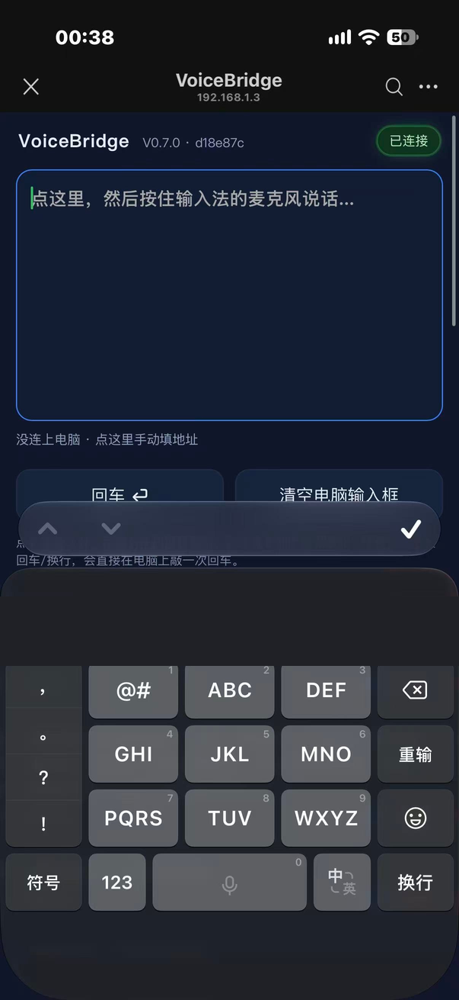 | 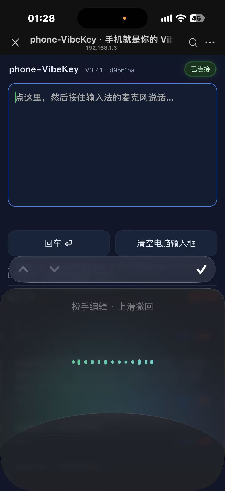 | 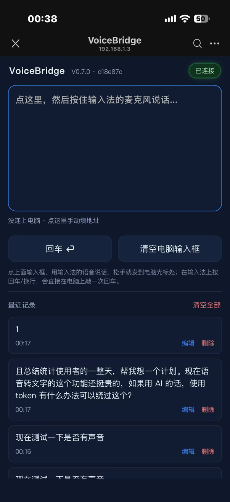 | 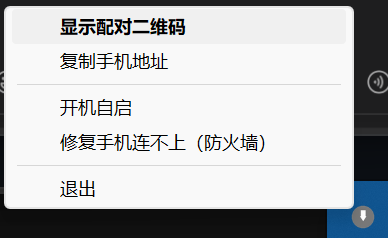 |

> `01-phone.png` 为脱敏版：原截图的键盘工具栏建议词条里带出过凭据前缀，已整条遮除。
